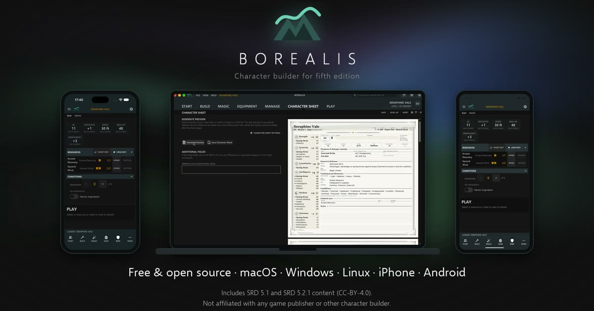
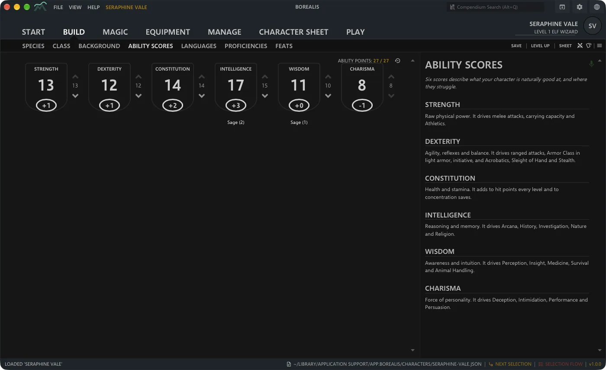
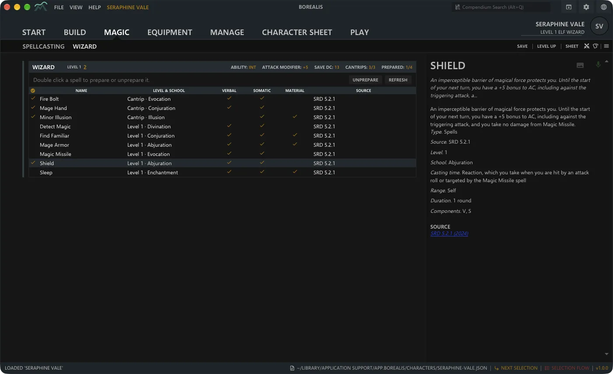
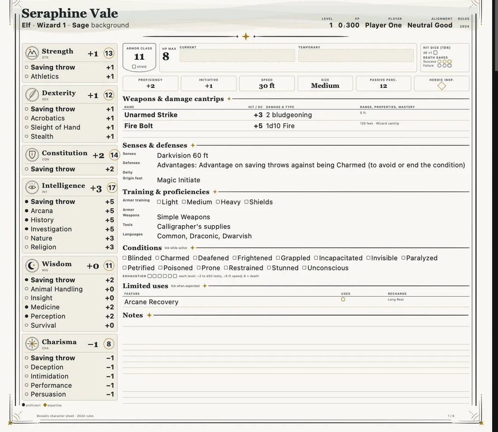
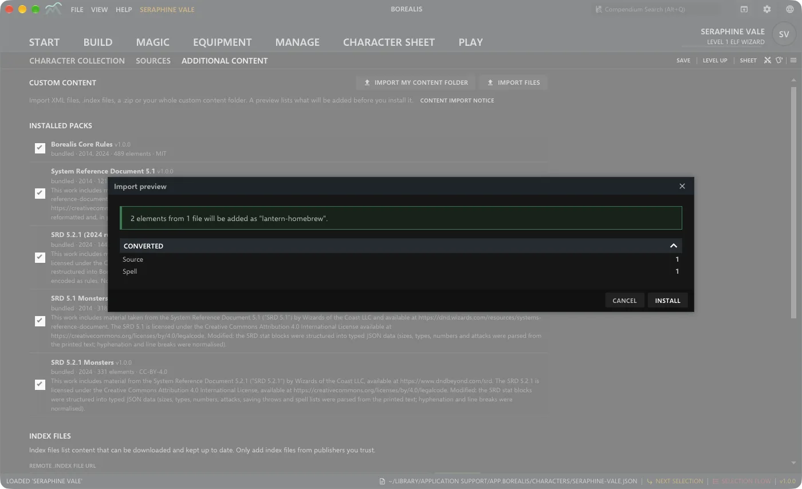
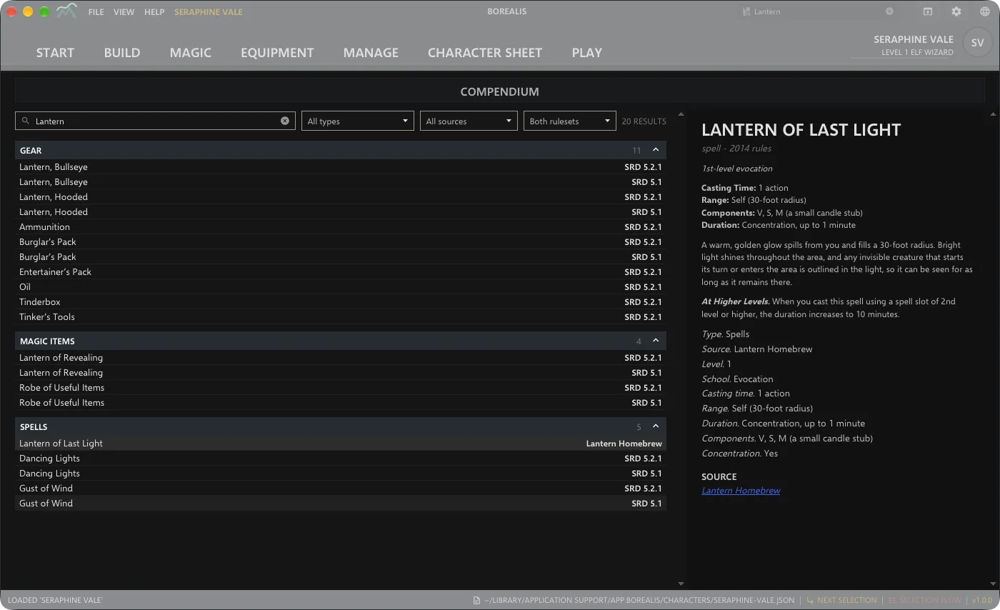
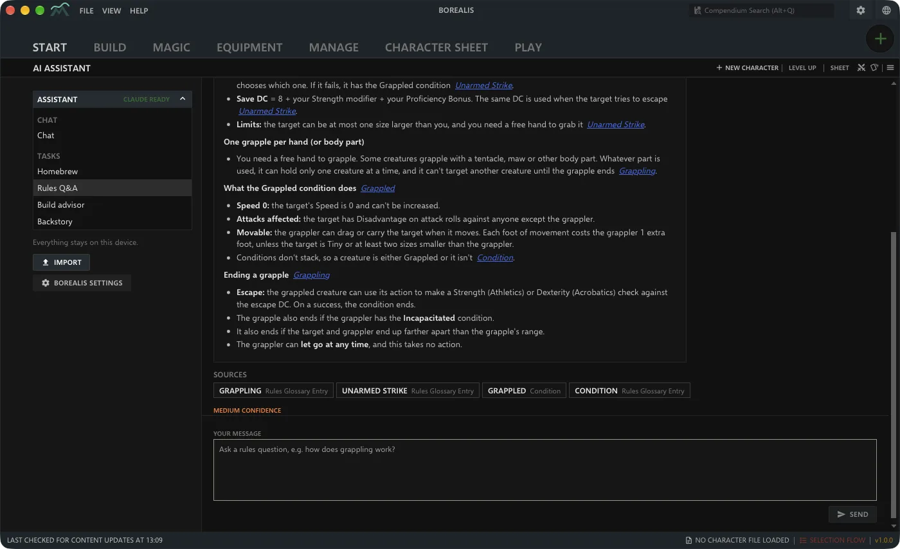
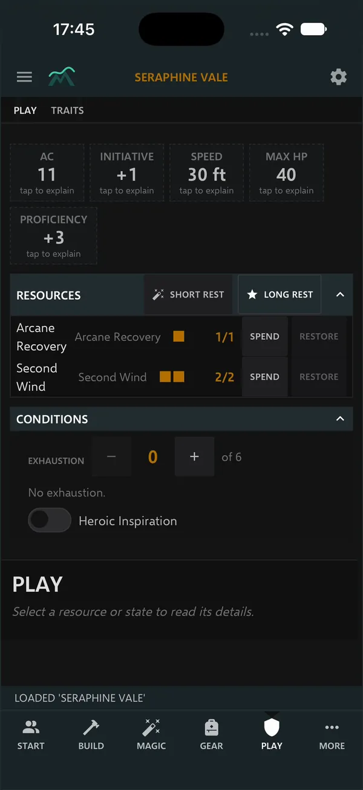
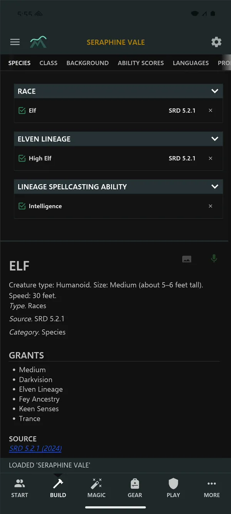

<div align="center">

<a href="https://borealisbuilder.com"></a>

<h3>Build, level up and print your tabletop heroes.</h3>

<p>Free and open source, on your desktop and your phone, and everything stays on your device.<br>No account, no ads, no telemetry.</p>

<p>
<a href="https://borealisbuilder.com"></a>
<a href="https://github.com/alon-mini/borealis/releases/latest"></a>
<a href="https://github.com/alon-mini/borealis/actions/workflows/ci.yml"></a>
<a href="#licence"></a>
</p>
<p>


</p>

<h2><a href="https://borealisbuilder.com">Download Borealis at borealisbuilder.com</a></h2>

<p><a href="https://borealisbuilder.com"><b>Website and downloads</b></a> &nbsp;·&nbsp; <a href="https://github.com/alon-mini/borealis/releases">GitHub Releases</a> &nbsp;·&nbsp; <a href="#for-developers">Build from source</a></p>

<sub>Version 1.0.0 &nbsp;·&nbsp; 2014 and 2024 rules &nbsp;·&nbsp; SRD 5.1 and SRD 5.2.1 included</sub>

</div>

---

## A tour of Borealis

Everything a character needs, nothing it doesn't. More on the [website](https://borealisbuilder.com).

<table>
<tr>
<td width="50%" valign="top" align="center">

<h4>Create and level up, step by step</h4>
Species or race, class, background, ability scores, languages, proficiencies, feats and gear, in the order you would do it at the table. Roll your scores, use point buy or the standard array, then level up from 1 to 20 and multiclass.
</td>
<td width="50%" valign="top" align="center">

<h4>Spells, slots and spellbooks</h4>
Pick cantrips and spells for every caster, keep a wizard's spellbook, prepare the day's list and read every spell in full. Slots follow your levels, including multiclass casters.
</td>
</tr>
<tr>
<td width="50%" valign="top" align="center">

<h4>A character sheet worth printing</h4>
Generate a clean PDF: stats, skills, attacks, features, spell pages and cards. Colour or ink-saving, fillable or flattened, Letter or A4.
</td>
<td width="50%" valign="top" align="center">

<h4>Bring the content you already have</h4>
Imports Aurora Builder XML content and <code>.dnd5e</code> character files, shows a preview of what will be added, then installs it. It can also read your own local 5etools data folder. Plain offline parsing, no AI involved.
</td>
</tr>
<tr>
<td width="50%" valign="top" align="center">

<h4>Homebrew, in the compendium</h4>
Drop a file, check the preview, install. Imported content can target either edition, and the compendium filters by rule set.
</td>
<td width="50%" valign="top" align="center">

<h4>Bring your own AI, if you want one</h4>
Optional, off by default, and nothing needs it. When on, it runs locally through the command-line tool you already have, with your own account, and answers link to the rules text you have installed. Desktop only.
</td>
</tr>
</table>

<div align="center">

### The same app in your pocket

Borealis runs on iPhone and Android as well as macOS, Windows and Linux. Track hit points, resources, rests and conditions during play.


&nbsp;&nbsp;&nbsp;


</div>

### Two editions, one app

| | **2014 (SRD 5.1)** | **2024 (SRD 5.2.1)** |
|---|---|---|
| Heritage | Races and subraces with ability score bonuses | Species with traits instead of fixed bonuses |
| Backgrounds | Proficiencies, languages and gear | Raise ability scores and grant an origin feat |
| Classes | The original classes, subclasses and spell lists | Revised classes, weapon mastery and updated spells |

You choose the edition per character, and it follows that character to level 20.

### Importing your own 5etools data

If you keep a local copy of 5etools data that you are entitled to use, Borealis can convert it on your device.

1. Open **Start → Additional content** and find **5etools import**.
2. Choose **Scan folder…** and pick the `data/` folder of your local copy.
3. Tick the source books you own. **Include fluff** adds descriptions and lore text.
4. Choose **Import N book(s)**. Borealis shows a report of anything it converted only partly or skipped.

The imported books are then installed next to the bundled SRD content, ready to use when you build a character.

Only import content you own or are licensed to use. Borealis reads the files from disk and converts them locally; it downloads nothing, ships no 5etools data and does not tell you where to get it. Converted packs are for your personal use: do not share or redistribute them. Borealis is not affiliated with 5etools.

### Yours, and only yours

- **No account.** No sign-up, no cloud save, no ads. Characters are files you can copy, back up and share.
- **No telemetry.** Borealis does not phone home; it goes online only when you ask it to.
- **AI only if you say so.** Optional and off by default.
- **Free, forever.** MIT OR Apache-2.0, so anyone can build it from source.

> **First launch:** the builds are not code-signed yet, so macOS and Windows warn you once. Step-by-step instructions are in the [FAQ on the website](https://borealisbuilder.com/#faq).

---

## For developers

Cross-platform D&D 5e character builder. Rust core + Tauri 2 shell + React/TypeScript UI.
Targets: Windows, macOS, Linux, iOS, Android. Bundle id `app.borealis`.
Website and downloads: https://borealisbuilder.com

<details open>
<summary><b>Layout</b></summary>

| Path | Purpose |
|------|---------|
| `crates/borealis-content` | JSON content schema, loaders, validation |
| `crates/borealis-engine` | Rules engine, ruleset profiles 2014/2024 |
| `crates/borealis-character` | Character model, save/load, legacy import |
| `crates/borealis-migrate` | XML to JSON migrator (lib + `borealis-migrate` CLI) |
| `crates/borealis-sheet` | Sheet rendering (PDF / HTML preview) |
| `crates/borealis-ai` | Local LLM CLI bridge (desktop only) |
| `crates/borealis-assist` | Engine-grounded AI features (explain, advisor, planner, homebrew, import) |
| `crates/borealis-encounter` | Deterministic encounter math (2014 and 2024 rules) |
| `crates/borealis-import-5etools` | Importer for a user's own local 5etools data |
| `crates/borealis-mcp` | Read-only stdio MCP server (`borealis --mcp`) |
| `crates/borealis-android-assets` | Reads the APK assets folder over JNI |
| `src-tauri` | Tauri shell (crate `borealis`) |
| `ui` | Vite + React 18 + TS (strict) frontend |
| `content` | Bundled content packs (core rules, SRD 5.1, SRD 5.2.1) |
| `content-tools` | Scripts that build the SRD content packs |
| `e2e` | End-to-end tests (web, desktop and mobile engines) |
| `tools` | Asset tooling (sheet art) |
| `docs` | Build guide, UI/API contract and format notes |

</details>

<details>
<summary><b>Prerequisites</b></summary>


- Rust stable (`rustup` recommended; required for mobile targets) and Node 20+.
- macOS: Xcode CLT (desktop) / full Xcode (iOS). Linux: `libwebkit2gtk-4.1-dev libappindicator3-dev librsvg2-dev patchelf libssl-dev libxdo-dev`. Windows: WebView2 + MSVC build tools.
- Mobile: see [docs/build.md](docs/build.md).

</details>

<details>
<summary><b>Commands</b></summary>


```sh
(cd ui && npm install)           # once
cargo build --workspace
cargo test --workspace
cargo clippy --workspace --all-targets -- -D warnings
cargo fmt --all
(cd ui && npm test && npm run build)

npm run tauri -- dev                    # desktop dev (runs Vite on :1420)
npm run tauri -- build --debug          # desktop bundle (debug)
npm run tauri -- build                  # desktop bundle (release)

# Mobile (needs SDKs, see docs/build.md)
npm run tauri -- ios init     && npm run tauri -- ios dev
npm run tauri -- android init && npm run tauri -- android dev
```

`npm run tauri` proxies to the CLI in `ui/node_modules`. Run all of it from the repository root.

</details>

### Notes

- Bundled content is SRD 5.1/5.2 only (CC-BY-4.0; attribution required).
- AI features shell out to local CLIs and are desktop only; mobile pairs with a desktop over LAN.
- Capabilities are least-privilege (`core:default` only); add permissions per feature.

## Licence

The code in this repository is licensed under either of [MIT](LICENSE-MIT) or [Apache License 2.0](LICENSE-APACHE), at your option.

Borealis is an independent project, not affiliated with or endorsed by Wizards of the Coast or by the authors of Aurora Builder.

Bundled content and assets keep their own licences (see [NOTICE](NOTICE)):

- SRD 5.1 and SRD 5.2.1 content (`content/srd-5.1*`, `content/srd-5.2.1*`) is licensed under CC-BY-4.0 and requires attribution.
- Icons and fonts are listed with their licences in [ui/NOTICE](ui/NOTICE); licence texts are in [ui/licenses/](ui/licenses/).

Unless you explicitly state otherwise, any contribution intentionally submitted for inclusion in the work by you, as defined in the Apache-2.0 license, shall be dual licensed as above, without any additional terms or conditions.
